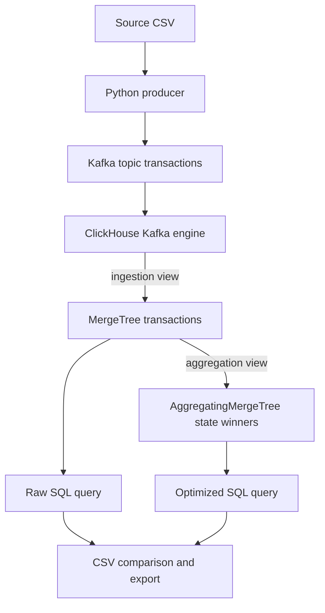

# Homework 2 — CSV → Kafka → ClickHouse

Author: **Ilya Drobyshevskiy**.

Find the category of the **largest individual transaction in each US state**.
The implementation includes a standalone CSV producer, Kafka ingestion through
a ClickHouse materialized view, separate SQL queries, result CSVs, and optimized
storage. Items 2 and 3 in the assignment repeat the same query requirement;
this project supplies both the raw-table query and its optimized equivalent.

## Quick start

Requirements: Docker Engine/Desktop with **Docker Compose v2.20+**, approximately
4 GB available memory, and internet access for the first image build. All Python
dependencies run in Docker; installing Python on the host is optional.

Start with the included synthetic data; no Kaggle account is needed:

```bash
docker compose up -d --wait kafka clickhouse
docker compose run --build --rm pipeline --csv /data/demo.csv --output-dir /results/demo
```

This creates the Kafka topic, applies `sql/01_schema.sql`, publishes all 20 demo
records, waits for ClickHouse, and compares the raw query, optimized query and
independent Python reference. The result appears at
`results/demo/largest_transaction_by_state.csv`, with evidence in
`results/demo/run_manifest.json`. A successful run ends with `Verified and exported`.

To use the supplied assignment data, extract **train.csv** from
`teta-ml-1-2025.zip` into `data/`. The archive also contains `test.csv` and
`sample_submition.csv`; the submission template contains no transactions.
Raw datasets are intentionally excluded from Git (train.csv exceeds GitHub's
100 MB regular-file limit).

If you already ran the demo, reset its containers and stored data first:

```bash
# Deletes this project's Kafka and ClickHouse volumes, including previous imports.
docker compose down -v
docker compose up -d --wait kafka clickhouse
docker compose run --build --rm pipeline --csv /data/train.csv --output-dir /results/train_run
```

The import validates every source row before sending, waits for every Kafka
delivery acknowledgement, then waits for the expected number of unique IDs in
ClickHouse. It fails on invalid input, delivery errors, missing rows, or different
query results. A nonempty transaction table is rejected to prevent accidentally
mixing separate imports. Reset **both** Kafka and ClickHouse together before a new
run; truncating only ClickHouse does not rewind Kafka offsets.

For train and test together, extract both files and run on fresh volumes:

```bash
docker compose run --build --rm pipeline --csv /data/train.csv /data/test.csv --output-dir /results/all_run
```

## Submitted results and dataset

| Input | Transactions | State codes | Categories | Result |
| --- | ---: | ---: | ---: | --- |
| train.csv (default) | 786,431 | 51 | 14 | [Training result](results/largest_transaction_by_state.csv) |
| train.csv + test.csv | 1,048,575 | 51 | 14 | [Combined result](results/largest_transaction_by_state_all.csv) |

State codes include DC. `target` is not needed for this analytical task and is
absent from test.csv. Both sources span 2019-01-01 through 2020-03-10.
[The audit](results/dataset_summary.json) records exact row counts, SHA-256
checksums, validity checks and result provenance.

The committed result CSVs were calculated from the entire supplied datasets with
exact decimal arithmetic and independently checked using pandas integer cents.
They are **reference results, not a claim of an executed Kafka/ClickHouse run**.
Running the commands above creates actual ClickHouse exports and a run manifest.
See [validation status](docs/validation.md) for the checks performed in the
development environment and the remaining integration check.

Output columns: `us_state,cat_id,max_amount,transaction_id`. Amount means the
largest single transaction, not the category with the greatest total spending.
Equal amounts choose the lexicographically greatest `transaction_id`, ensuring
that all implementations choose the same record. IDs are SHA-256 of
`<CSV basename>:<one-based data row>`; row numbering excludes the header.
The input files and their basenames must remain unchanged for reproducible IDs.

## Architecture and assignment files



| Requirement | Implementation |
| --- | --- |
| Separate CSV → Kafka Python script | [app/producer.py](app/producer.py) |
| Separate ingestion DDL | [sql/01_schema.sql](sql/01_schema.sql) |
| Category of maximum transaction by state | [sql/02_largest_transaction_by_state.sql](sql/02_largest_transaction_by_state.sql) |
| Optimized query | [sql/03_largest_transaction_by_state_optimized.sql](sql/03_largest_transaction_by_state_optimized.sql) |
| Storage optimization | Optimized DDL in `01_schema.sql`, [explanation](docs/optimization.md) |
| Before/after comparison | [sql/04_baseline.sql](sql/04_baseline.sql), [app/benchmark.py](app/benchmark.py) |
| Reproducible environment | `Dockerfile`, `requirements.txt`, `docker-compose.yml` |
| Tests | `tests/`, GitHub Actions workflow |

The analytical schema keeps timestamp, amount, state, category, and source
provenance. Names, addresses and other columns unrelated to the assignment are
not sent to Kafka. Source timestamps lack a timezone; they are stored as UTC
without shifting their displayed values. This convention does not affect the
maximum-per-state query. Money is represented as a decimal string in JSON and
`Decimal(18,2)` in ClickHouse, avoiding binary floating-point rounding.

## Run the SQL directly

After a successful pipeline run, export either query without re-importing data:

```bash
docker compose exec -T clickhouse clickhouse-client --user homework --password homework_local_only --format CSVWithNames < sql/02_largest_transaction_by_state.sql > results/raw_query.csv
docker compose exec -T clickhouse clickhouse-client --user homework --password homework_local_only --format CSVWithNames < sql/03_largest_transaction_by_state_optimized.sql > results/optimized_query.csv
```

`00_storage.sql` contains only the durable tables and aggregation view for
isolated SQL testing. `01_schema.sql` is the complete, self-contained setup used
by the pipeline. `CREATE IF NOT EXISTS` allows rerunning DDL but is not a schema
migration mechanism for existing tables.

To exercise the standalone producer independently, initialize a fresh stack
and apply DDL first:

```bash
docker compose up -d --wait kafka clickhouse
docker compose run --rm kafka-init
docker compose exec -T clickhouse clickhouse-client --user homework --password homework_local_only --multiquery < sql/01_schema.sql
docker compose run --build --rm --entrypoint python pipeline -m app.producer --csv /data/train.csv --manifest /results/producer_manifest.json
```

The standalone producer reports Kafka acknowledgement, not ClickHouse completion.
Use the automated pipeline for the complete wait/verify/export workflow.

## Why the optimized query is faster

`LowCardinality` encodes repeated state/category values; ZSTD compresses the
analytical columns; Delta encoding improves timestamp compression. Ordering by
state and timestamp helps state-filtered access. These changes alone do not
eliminate the all-state aggregation scan.

The principal query optimization is the incremental `AggregatingMergeTree`
table. Its materialized view stores an `argMaxState` per state for each inserted
block. `argMaxMerge` combines those states at query time, including before
background merges finish. It reads the compact aggregate table instead of every
transaction. The extra aggregate storage and ingestion work are the trade-off.

Measure actual timings, scanned rows/bytes and compressed storage after importing:

```bash
docker compose run --rm --entrypoint python pipeline -m app.benchmark --runs 5 --output /results/benchmark.json
```

This rebuilds only the disposable `transactions_baseline` table, merges parts
outside the timed section, warms each query, disables the query result cache and
checks that all three query variants return identical results. It records actual
measurements, not estimated speedup. Stop concurrent ingestion while benchmarking.
Compare baseline storage with the **sum** of optimized raw and aggregate storage.
No benchmark numbers are claimed until this command has been run.

## Delivery semantics and limitations

The producer enables Kafka idempotence and requires `acks=all`. The single-broker
development setup has replication factor 1, so it is not highly available.
ClickHouse's Kafka engine provides at-least-once ingestion; a crash/retry can
duplicate raw rows. `argMax` is duplicate-insensitive, so identical replayed
transactions do not change this task's result. The pipeline records both physical
and unique row counts; the raw table must not be used as an exactly-once count or
sum. IDs identify rows of an unchanged source file, not an arbitrary business
transaction across edited files. Concurrent import jobs are unsupported.

This is a local exercise: Kafka is internal to Docker and ClickHouse binds only
to `127.0.0.1:8123`. The example password is local development configuration.
Production deployment would require separate credentials, access controls and
replicated infrastructure.

## Tests and troubleshooting

```bash
python -m unittest discover -s tests -v
python -m app.producer --csv data/train.csv --validate-only
python -m app.reference --csv data/train.csv --output results/reference_train.csv
docker compose ps -a
docker compose logs --tail=100 kafka clickhouse
docker compose exec -T clickhouse clickhouse-client --user homework --password homework_local_only --multiquery < sql/05_diagnostics.sql
```

The unit tests run using the standard library. GitHub Actions also launches the
real containers and verifies the synthetic demo through Kafka and both SQL
queries. Until that job runs successfully, its integration status is unverified.

If port 8123 is occupied, change only the host side of its Compose mapping.
If a file is missing, verify `data/train.csv` exists before launching the pipeline.
If a container reports out-of-memory, raise Docker's memory allocation. If
ingestion stalls, inspect `system.kafka_consumers` via the diagnostics SQL; invalid
messages fail visibly instead of being silently skipped. A failed partial import
should be reset with `docker compose down -v` before retrying.

## Publish to GitHub

The local Git history uses Ilya Drobyshevskiy's name and the GitHub noreply address
associated with `free001style`. Create an empty **public** repository named
`clickhouse-kafka-homework`, then push:

```bash
git remote add origin https://github.com/free001style/clickhouse-kafka-homework.git
git push -u origin main
```

Submit that public repository URL. The raw dataset is not required for the
included demo or CI; reviewers can place the supplied archive's train.csv in
`data/` to reproduce the full result.

## Sources

- [Assignment dataset on Kaggle](https://www.kaggle.com/t/1918f3f6435300327d38d6c596f97394)
- [ClickHouse Kafka table engine](https://clickhouse.com/docs/engines/table-engines/integrations/kafka)
- [AggregatingMergeTree](https://clickhouse.com/docs/engines/table-engines/mergetree-family/aggregatingmergetree)
- [argMax](https://clickhouse.com/docs/sql-reference/aggregate-functions/reference/argmax)
- [Apache Kafka 3.9 quick start](https://kafka.apache.org/39/getting-started/quickstart/)
- [Confluent Python producer API](https://docs.confluent.io/platform/current/clients/confluent-kafka-python/html/index.html)
